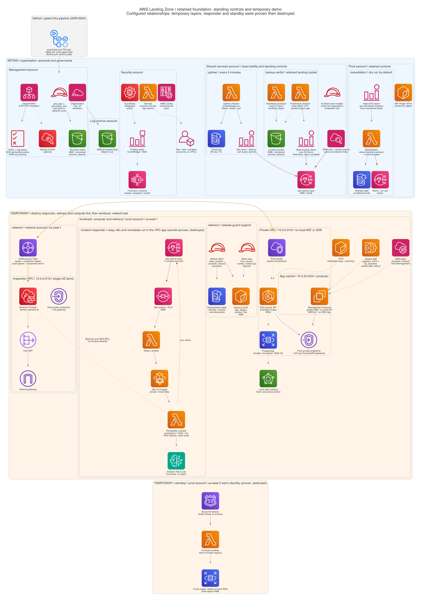

# AWS Landing Zone

**Infra pipeline status:** proven live and torn down on 2026-10-15. The network,
workload and delivery roots now plan on every pull request with a read-only
member role, apply on merge behind a reviewer-gated environment, replan to prove
a second plan is empty, and destroy through a gated workflow with a post-destroy
hourly check. The first live runs caught two real defects, both failed safe. See
[Infra pipeline](#infra-pipeline) and
[ADR-0004](docs/adr/0004-gated-infra-pipeline.md).

**Compute baseline status:** deployed, proven and destroyed on 2026-10-06. The
compute guardrails are live on the Sandbox and Workloads OUs
(`scripts/test-guardrails.sh` 20/20, dry-run denials in sandbox and prod). In one
session the prod defaults, the golden AMI pipeline, SSM patching and the private
management instance were applied alongside the full EKS and RDS workload, then
torn down: `test-data-tier.sh` 5/5, golden AMI test phase `HARDENING_OK` after a
reboot, `scripts/test-compute.sh` 17/17, `scripts/verify-teardown.sh` clean. See
[docs/compute-baseline.md](docs/compute-baseline.md) for the run and the fixes
the first live bake forced.
Existing verification below covers the earlier EKS/RDS and network demo.

**Incident tooling status:** deployed, proven and torn down on 2026-10-06. The forensics
runbook and finding routing stay up as standing controls in the security account. Drills
and a forced-alarm remediation with an RDS failover passed; the live run found two real
bugs (an evidence step that ran before the snapshot finished, and an SCP that made a
resource undestroyable). A second responder session on 2026-10-17 proved the standing
uptime alarm reaches the inbox as notify-only, with an incident summary written by Amazon
Nova Lite in a real run. Claude was dropped for the summary: this account cannot call it
in-region. The responder was destroyed again afterwards. See
[docs/incident-response.md](docs/incident-response.md).

**Standing controls status:** `uptime/`, `backup-verify/` and `remediation/` were
deployed on 2026-10-16 and stay up. Their failure proofs ran on 2026-10-17: a failing
uptime check alarms, an empty backup bucket alarms, and remediation was proven with forced
alarms and with real CPU load in dry run. A synthetic heartbeat now writes to the landing
bucket every 6 hours. A stale backup object alarming is **not proven yet**. See
[docs/standing-controls.md](docs/standing-controls.md).

**Warm standby status:** the us-west-2 data-tier standby was deployed, proven and
destroyed on 2026-10-07. `scripts/test-standby.sh` passed 8 of 8: encrypted cross-region
replica on a multi-region key, replication, DNS failover, and automated replica promotion.
A full second hub was designed and not built. See
[docs/warm-standby-design.md](docs/warm-standby-design.md).


The public repository is
[jordann6/aws-landing-zone](https://github.com/jordann6/aws-landing-zone).
State moved to a dedicated backend under `aws-landing-zone/` keys
([State backend](#state-backend)). Resource tags carry
`Project = aws-landing-zone`.

A Terraform AWS landing zone with a persistent multi-account organization,
inherited guardrails, centralized audit and security controls, and an inspected
private workload network. The reference workload is private EKS and Multi-AZ
PostgreSQL. Application integration is outside the completion scope.



The diagram shows the infrastructure design and configured relationships, not a
running application or proof of traffic. Blue clusters are retained: the organization,
governance, observability and the standing controls. Orange clusters are temporary: the
network, workload, compute and delivery layers, the incident responder and the us-west-2
standby, all destroyed after their proofs. The grey cluster is the GitHub pipeline. The
responder's ops-alarms node is the shared-services topic, drawn again inside the
responder. Dev, test and sandbox accounts exist without deployed spoke VPCs. Cross-region
backup is disabled; the standby uses a cross-region RDS replica.

## Proven in live runs

Every layer below was deployed, proven against the real organization, and torn down.
Results are from applied saved plans, not from plans alone: by the operator for
the earlier layers, and by CI behind reviewer gates for the infra pipeline.

| Layer | What was proven | Where |
|---|---|---|
| Infra pipeline | 196 resources applied through CI across three roots (network 50, workload 116, delivery 30) over two runs, the first stopping safely at 47 of 50 network resources on a defect; second plan empty, gated destroy to empty state with the hourly check passing on each root | [ADR-0004](docs/adr/0004-gated-infra-pipeline.md) |
| Guardrails and compute | 20/20 guardrail denials, hardened golden AMI after reboot, private management instance 17/17 | [compute-baseline](docs/compute-baseline.md) |
| Secrets scanner | Cross-account scan of all members, positive control flagged, value reads explicitly denied | [secrets-lifecycle](docs/secrets-lifecycle.md) |
| Incident tooling | Finding to forensics runbook, isolation drill with encrypted evidence, forced alarm to RDS failover in about 35 seconds; standing uptime alarm handled notify-only with an Amazon Nova Lite summary | [incident-response](docs/incident-response.md) |
| Standing controls | Failing uptime check alarms; empty backup bucket alarms; heartbeat producer writes to the bucket; remediation dry run, reboot, cooldown, unmonitored skip and circuit breaker, plus real CPU load raising the alarm in dry run | [standing-controls](docs/standing-controls.md) |
| Warm standby | us-west-2 replica on a multi-region key, DNS failover, automated promotion, 8/8 checks | [warm-standby-design](docs/warm-standby-design.md) |

Not proven, stated plainly: a stale backup object raising the freshness alarm, a real
reboot following real CPU load (only dry run so far), restore of a real backup,
end-to-end firewall traffic, and a live listing of us-west-2 after the standby was
destroyed (Terraform's destroy and empty state are the evidence).

## Companion repositories

The incident tooling runs here as a landing-zone control. The projects are separate
repositories with their own history and a landing-zone mode:

| Repository | Role in this landing zone |
|---|---|
| [aws-incident-forensics](https://github.com/jordann6/aws-incident-forensics) | Containment and evidence runbook, a standing control in the security account |
| [aws-incident-responder](https://github.com/jordann6/aws-incident-responder) | Private n8n remediation workflow in the prod account, hourly; notify-only for the standing alarms |
| [aws-secrets-lifecycle](https://github.com/jordann6/aws-secrets-lifecycle) | The scanner deployed into the security account |

The portfolio write-up is the AWS Landing Zone case study at
[jordandesigns.io](https://jordandesigns.io).

## Current status and remaining work

Before teardown, Phase C verification recorded **50 network resources and 85
workload resources deployed** in `us-east-1`. Network Firewall was READY and
IN_SYNC, both RAM associations were ASSOCIATED, and prod could see the shared
Transit Gateway.
EKS 1.35 and its two-node AL2023 group were ACTIVE. PostgreSQL 16.14 was available,
private, encrypted and Multi-AZ. Private endpoints and TGW routing were verified.
These checks establish infrastructure state and configuration. Forced database
failover was demonstrated later by the incident tooling; end-to-end firewall traffic
has not been demonstrated.

**Workload teardown is complete.** Live checks confirm zero workload state
resources, EKS clusters, nodes, RDS instances and prod interface endpoints, with
the backup vault and app repository gone. The initial apply removed 84 resources
but timed out disabling Inspector; an Inspector-only recovery removed the final
resource. The diagram above records the demonstrated design, not current live
workload inventory.

**Network teardown is complete:** all 50 managed resources were destroyed.
Final state and live API checks confirm zero demo EKS, RDS, nodes, interface
endpoints, NAT gateways, Transit Gateways and firewalls. Both demo states are
empty and the backup vault is gone. All member accounts remain ACTIVE;
organization RAM onboarding, governance, observability and backend state are
retained. CloudTrail is logging, and the OAM sink, both source links and five
central alarms remain present.

The demonstrated hourly layers have been removed. Retained baseline services,
KMS deletion windows and storage can still generate charges; check billing after
reporting catches up. Follow the [completion runbook](docs/completion.md) for verification and
future demo lifecycle guidance. Commit, push and merge only when requested.

LLM gateway integration is cancelled and was never deployed. Provider domains and gateway output
contracts have been removed from configuration. Network allowlist edits were not
applied before the hub was removed; workload integration resources have also
been removed. Legacy state-history cleanup is complete: 20 obsolete gateway
versions were deleted and the latest clean state retained. Retiring the old
gateway provider keys remains separate unfinished work.

The secrets scanner is live in the security account (a few dollars a month): seven
metadata-only target roles plus its own, a cross-account scan that assumed into
every member account, and a positive control where an empty secret created in
sandbox was inventoried and flagged. See [docs/secrets-lifecycle.md](docs/secrets-lifecycle.md).

## Account and policy boundaries

Security, Infrastructure, Workloads and Sandbox OUs contain eight member accounts:
security, network, shared-services, log-archive, dev, test, prod and sandbox.
SCPs deny root use, leaving the organization, unapproved regions, public or
unencrypted S3, and disabling detective services. The organization also supplies
a tag policy. Member accounts inherit the applicable controls; the management
account is exempt from SCPs and needs its own hardening.

Accounts carry `close_on_deletion = false` and `prevent_destroy`. Never close or
suspend them as part of a demo teardown. Organizations, OUs, SCPs and idle accounts
have no direct service fee; resources retained in those accounts can still bill.
Permanent RAM organization onboarding lives in the accounts root, so destroying
the network does not disable sharing for future demos.

## Terraform layers

| Root | Purpose | Lifecycle |
|---|---|---|
| `accounts/` | Organization, OUs, accounts, SCPs, tag policy and RAM organization onboarding | Permanent |
| `bootstrap/` | Dedicated state backend, GitHub OIDC trust, management `gha-plan` and `gha-apply`, and their matching roles in network and prod | Retained, operator-applied |
| `terraform/` | Audit, detective controls, identity and budgets | Retained baseline |
| `observability/` | CloudWatch OAM links, central alarms, the ops-alarms topic and security findings routing | Retained baseline |
| `network/` | Shared TGW, inspection VPC, firewall, NAT, endpoints and network logs | Temporary, hourly billing |
| `workload/` | Private prod VPC, EKS, RDS, backup, EC2 defaults, golden AMI pipeline and SSM patching | Temporary, hourly billing |
| `delivery/` | release-guard support in prod: GitHub OIDC publish and promote roles, ECR repositories, the deployments table and IRSA roles | Temporary, destroyed first by `destroy.yml` |
| `compute/` | Hardened management instance from the golden AMI, SSM-only access | Temporary, destroyed first |
| `secrets/` | Metadata-only scan-target roles for the secrets scanner in every member account | Retained, near zero cost |
| `incident/` | Forensics target roles in prod, the incident alarm reader in shared-services and the n8n image mirror. The runbook, its finding routing and the responder deploy from their companion repositories in landing-zone mode | Retained; the responder is temporary |
| `standby/` | us-west-2 warm standby: multi-region KMS, encrypted cross-region replica, Route 53 failover, promotion | Temporary, destroyed after proof |
| `uptime/` | 5-minute website check with metrics and alarms to the ops topic (shared-services) | Retained, small standing cost, deployed 2026-10-16 |
| `backup-verify/` | Retained, private landing bucket (kept through teardowns), a synthetic heartbeat producer every 6 hours, a daily freshness check and an optional stale alarm (shared-services) | Retained, small standing cost, deployed 2026-10-16 |
| `remediation/` | Tag-scoped, circuit-broken EC2 reboot Lambda (prod), dry run by default | Retained, small standing cost, deployed 2026-10-16 |

The last three are described in [standing-controls](docs/standing-controls.md) and
[ADR-0005](docs/adr/0005-remediation-safety-model.md): deployed and smoke checked on
2026-10-16; the uptime, backup and remediation failure proofs ran 2026-10-17 (remediation
with forced alarms: dry run, reboot, cooldown, unmonitored skip and circuit breaker; then real
CPU load raised the alarm on its own and drew a dry-run notice), and ADR-0005 is accepted.
The heartbeat producer followed the same day. The stale-object alarm proof is pending.

Phase A observability is included in this repository. Its shared-services
CloudWatch OAM sink, prod/network links, central alarms and security findings
routing are retained. The workload includes the Container Insights add-on and
IRSA configuration for a future operator-reviewed deployment; that add-on was
not part of the completed Phase C demo.

### Governance

| Control | Implementation |
|---|---|
| Audit | Organization CloudTrail and Config delivery to encrypted S3; GOVERNANCE-mode Object Lock and trail validation |
| Detection | GuardDuty delegation; optional Security Hub CIS AWS Foundations 1.4.0 integration; AWS Config |
| Identity | Optional IAM Identity Center personas, permission boundaries and short sessions |
| Encryption | Customer-managed KMS keys with rotation and scoped service policies |
| Root use | Management password policy and EventBridge root-use alerting |
| Cost | Monthly budget; optional Cost Anomaly Detection monitor |

Optional integrations are controlled by Terraform variables. They must not be
reported as deployed merely because their definitions exist.

### Inspected network

The network account hosts the `10.0.0.0/16` inspection VPC. RAM shares the Transit
Gateway with the organization; prod attaches through explicit acceptance. Separate
spoke and inspection route tables route internet egress and return traffic through
Network Firewall and the hub NAT. The demo inspection path uses one availability
zone and is not a production availability design.

The source allowlist now defaults to AWS and Cognito domains. The prod source CIDR
is included in firewall HOME_NET. Hub interface endpoints, an S3 gateway endpoint,
VPC flow logs and firewall flow/alert logs support private access and investigation.

### Private reference workload

| Component | Implementation |
|---|---|
| VPC | `10.3.0.0/16`, private subnets, no local IGW or NAT; TGW inspection route |
| Access | Prod's own interface endpoints for ECR, STS, EC2, ELB, Logs, Monitoring, EKS, SSM and Secrets Manager; S3 gateway endpoint |
| EKS | Private API, encrypted secrets, IRSA and two AL2023 managed nodes |
| PostgreSQL | Encrypted private Multi-AZ RDS with a managed secret; app-to-DB security group access on port 5432 and data subnet NACL |
| Backup | Daily local AWS Backup and Vault Lock with a demo grace period; cross-region copy requires explicit region approval and opt-in |
| Supply chain | Immutable ECR tags, scanning, pull-through cache, Inspector and an on-demand Image Builder pipeline |
| Compute baseline | EBS default encryption on a CMK, IMDSv2 defaults, node launch template, STIG + `cis_baseline` golden AMI, SSM patch baseline; see [compute baseline](docs/compute-baseline.md) |

The deployed node group uses the standard AL2023 EKS image, which stays the node
image by design. The golden AMI is for standalone instances: one was built and
tested in the 2026-10-06 session and deleted at teardown. No application
has been deployed to prove the permitted app-to-database path.

## Infra pipeline

The hourly roots (network, workload, delivery) build and tear down through CI.
Design and the live proof are in [ADR-0004](docs/adr/0004-gated-infra-pipeline.md).

| Workflow | Trigger | What it does |
|---|---|---|
| `guardrails.yml` | Pull request | Static gates on every root; credentialed plan for network, and for workload and delivery when their upstream state is live, using the read-only member `gha-plan` |
| `apply.yml` | Push to main on those roots, or dispatch | Only when `HOURLY_STACK_ENABLED` is `true`. network, workload, delivery in order, each replaying its reviewed saved plan behind the `prod-apply` environment; then replans all three and fails if a second plan is not empty |
| `destroy.yml` | Dispatch, main only | delivery, workload, network, each behind the `destroy` environment and followed by the hourly-resource check |
| `ttl-guard.yml` | Hourly schedule, or dispatch | Read-only check that fails while network or workload holds anything hourly. Best effort: GitHub may delay or drop scheduled runs |

Bring the stack up and down (reviewer approves each root at its gate):

```bash
gh variable set HOURLY_STACK_ENABLED --repo jordann6/aws-landing-zone --body true
gh workflow run apply.yml --repo jordann6/aws-landing-zone --ref main
# prove, then
gh workflow run destroy.yml --repo jordann6/aws-landing-zone --ref main
gh variable set HOURLY_STACK_ENABLED --repo jordann6/aws-landing-zone --body false
```

The stack costs about $1.16 an hour and the workload apply takes about 28
minutes. Finish the teardown before 05:00 UTC, when the workload backup plan
writes into a Vault Lock vault whose recovery points block its deletion for 7
days. Check that vault for recovery points before dispatching the destroy.

Inputs come from upstream remote state (account ids, Organization ARN, Transit
Gateway id), so CI needs no var files. The member account role is chosen by an
ephemeral `ci_stage` variable that platform-guardrails sets per job; unset, it
falls back to `OrganizationAccountAccessRole`. The account EBS encryption default
is guarded by a `removed` block, so no `terraform state rm` is needed before a
destroy.

### Local fallback

An operator can still plan and apply locally with reviewed saved plans.
`phase-c.tfvars.json` is optional now; an explicitly set variable still wins over
the state-sourced value. The private input exporter reads existing account and
network state:

```bash
python3 scripts/prepare-workload-inputs.py --workload
terraform -chdir=workload fmt -check
terraform -chdir=workload validate
terraform -chdir=workload plan -var-file=phase-c.tfvars.json -out=tfplan -input=false
terraform -chdir=workload show tfplan
```

The exporter requires the deployed network. Generated inputs, state and saved
plans stay private and gitignored. Its previous filename remains a compatibility
entry point. A saved plan must match the intended operation and current state
before an operator applies it.

Guardrail verification scripts check the organization structure, logging and
selected live deny behavior. They do not measure RDS failover or prove application
traffic. The state-based `scripts/verify-teardown.sh` is a supplemental check;
completion requires live inventory checks too, as described in the runbook.

Destroy **delivery, then workload, then network** (the order `destroy.yml`
uses). Do not use general `make destroy` for
this completion path because it also removes governance and audit buckets. Retain
the audit history and observability foundation. An expired compliance lock with
recovery points can block backup deletion until retention ends. KMS deletion
windows, Secrets Manager recovery windows, retained storage and baseline services
can leave residual charges after the hourly layers are gone. Check billing after
the reporting data catches up.

## State backend

Every root keeps state in a dedicated bucket that `bootstrap/state_backend.tf`
owns ([ADR-0003](docs/adr/0003-dedicated-state-backend.md)), under
`aws-landing-zone/<root>.tfstate`.

| Control | Implementation |
|---|---|
| Cannot be deleted by a plan | `lifecycle { prevent_destroy = true }` on the bucket and the CMK |
| Recoverable history | Versioning; noncurrent versions expire only beyond the newest 20 and after 90 days; incomplete uploads abort after 7 days |
| Encrypted under a key this repo controls | SSE-KMS on a rotated CMK with bucket keys; every backend sets `kms_key_id`, and the bucket policy refuses SSE-S3 uploads |
| Never public, never plaintext in transit | All four public access blocks, `BucketOwnerEnforced`, and a bucket policy denying non-TLS and TLS below 1.2 |
| No concurrent writers | `use_lockfile = true` (S3 lock object, no DynamoDB table) |

The CI roles get the bucket prefix and the CMK only through S3
(`kms:ViaService`). Migration from the legacy shared bucket is
`scripts/migrate-state-backend.sh phase1|phase2`; it never deletes the legacy
objects.

## Validation and CI

CI runs the shared [platform-guardrails](https://github.com/jordann6/platform-guardrails)
static gates (gitleaks, fmt/validate, tflint, Checkov, Trivy, conftest OPA) on
every root except `standby/`, and a `python_tests` job runs the standing-control unit
tests. OPA checks required tags and CostCenter. A repo-local Infracost workflow gates
network, workload, delivery and observability changes at a $50/month increase, with an explicit
`cost-approved` PR label override. It runs before the PR report, rejects missing
cost estimates, and stores each root's report separately. Hosted Infracost
policy enforcement is disabled because its example tagging rules conflict with
the organization's tag policy. Pricing estimates still use the Infracost API.

The credentialed plan, gated apply, gated destroy and TTL guard are live for the
network, workload and delivery roots; see [Infra pipeline](#infra-pipeline). CI
authenticates by GitHub OIDC with the immutable repository subject, into
management `gha-plan` or `gha-apply`, which each chain into exactly one matching
role in the member accounts. The accounts, governance, bootstrap and
observability roots stay operator-applied, so CI can never rewrite its own trust.

## Documentation

- [Completion runbook](docs/completion.md): completed teardown, verification and closeout steps.
- [Separate security cleanup](docs/security-cleanup.md): retired state-history cleanup without redeploying the gateway.
- [Secrets lifecycle](docs/secrets-lifecycle.md): metadata-only scanner roles in every member account, ninety-day credential alarms and the live proof.
- [Incident response](docs/incident-response.md): forensics runbook and responder in the org, the live proofs, the bugs they found and what is unproven.
- [Warm standby](docs/warm-standby-design.md): the us-west-2 design and cost gate, with the live result and teardown lessons.
- [Compute baseline](docs/compute-baseline.md): guardrails, golden AMI, patching, management instance and their proofs.
- [CIS mapping](docs/cis-mapping.md): controls mapped to resources and policies, with scope limitations.
- [Access model](docs/access-model.md): personas, account scope and permissions.
- [Data tier](docs/data-tier.md): segmentation, backup policy and availability design; proof limits are explicit.
- [State backend decision](docs/adr/0003-dedicated-state-backend.md): dedicated, KMS-encrypted backend instead of the shared bucket.
- [Gated infra pipeline](docs/adr/0004-gated-infra-pipeline.md): split plan and apply identities across accounts, reviewed-plan replay, second-plan check, the live proof and the two defects it caught.
- [Architecture decision](docs/accelerator-vs-bespoke.md): bespoke Terraform versus Control Tower and Landing Zone Accelerator.
- [Diagram source](docs/diagram.py): official AWS icons via the mingrammer `diagrams` library. Regenerate with `python3 docs/diagram.py` after installing `diagrams` and Graphviz.
